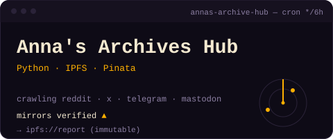

<b>English</b> · <a href="README.md">Spanish</a>

This is a terminal: click any command to open or close it.

<code>guest@d4vram:~$ ./about</code> &nbsp;about me

 

Hi, I'm **D4vRAM**. Self-taught developer with a neurodivergent mind. I learn by building: when I see a problem, I write the tool that fixes it — Android apps, scripts, bots and desktop apps. Almost everything I make is open source, local and tracking-free.

> *"What I love about programming: if there's an error, it's always human."*

- **How I learn:** Constant practice, theory when needed, AI as a personal guide.
- **Systems:** GNU/Linux · Windows · Android
- **Philosophy:** "One day at a time" — 2Pac

<code>guest@d4vram:~$ ls ~/projects</code> &nbsp;featured projects

 

<table>
<tr><td width="50%" valign="top">

  

<b>The problem:</b> Downloading whole playlists with yt-dlp from the terminal was a pain. <b>What I built:</b> A GUI for yt-dlp: paste a URL, pick a format (mp3, flac, opus…), done. Queue with progress, speed and ETA, styled like eMule and Ares. 100% local.

</td><td width="50%" valign="top">

  

<b>The problem:</b> Anna's Archive domains change constantly and it's hard to know which one works. <b>What I built:</b> A self-updating tracker: it crawls Reddit, X, Telegram and Mastodon for mirrors, verifies them and publishes an immutable report to IPFS every 12 hours.

</td></tr>
<tr><td width="50%" valign="top">

   

<b>The problem:</b> The Threads posts I saved depended on the platform itself. <b>What I built:</b> A private vault to save, tag and annotate Threads posts on your device. No account, no cloud, no tracking. For Android and desktop.

<a href="https://github.com/D4vRAM369/ThreadsVault">Android</a> · <a href="https://github.com/D4vRAM369/ThreadsVault-desktop">Desktop</a>
</td><td width="50%" valign="top">

  

<b>The problem:</b> WhatsApp voice notes sounded bad on Pixel phones. <b>What I built:</b> An LSPosed module with a configurable mic pre-boost. My first published project.

</td></tr>
</table>

<code>ls -a ~/projects</code> &nbsp;+7 more

 

- **[Debuggle](https://github.com/D4vRAM369/Debuggle)**  — AI debugging assistant: paste a stack trace, get it explained at your level.
- **[TapTranslate](https://github.com/D4vRAM369/TapTranslate)**  — Offline ES↔EN translation from Android's text-selection menu.
- **[AhorrApp](https://github.com/D4vRAM369/AhorrApp)**  — Supermarket price comparison for Gran Canaria.
- **[GranCanMatch_bot](https://github.com/D4vRAM369/GranCanMatch_bot)**  — Telegram bot to meet people in Gran Canaria — no pay-to-match. It's no longer deployed or running: the database never got good enough to make it viable, and it lacked marketing _(I don't like marketing, it's not my thing)_. It might reopen someday, but it's not in my plans for now.
- **[PsychoLogger](https://github.com/D4vRAM369/PsychoLogger)**  — Private, encrypted harm-reduction logbook. 100% offline.
- **[CBDcounter](https://github.com/D4vRAM369/CBDcounter)**  — Minimal consumption tracker with CSV export. Offline.
- **[NowPlayingExporterPy](https://github.com/D4vRAM369/NowPlayingExporterPy)**  — Exports rooted Pixels' Now Playing history to CSV.

<code>guest@d4vram:~$ cat stack.txt</code> &nbsp;what I work with

 

<code>languages</code> 

<code>frameworks</code> 

<code>tools</code> 

<code>guest@d4vram:~$ ./hire-me</code> &nbsp;let's work together

 

If you need any of these, I can help:

- Native Android apps (Kotlin + Jetpack Compose)
- Python scripts and automations
- Telegram bots
- Desktop apps (Tauri, Electron)

Tell me about your idea on Telegram and let's talk.

<code>guest@d4vram:~$ cat /etc/android-freedom</code> &nbsp;

 

> **[WARN]** Since September 2026, Google requires every developer to register their real identity to distribute APKs outside the Play Store. F-Droid, AOSP apps and privacy are at stake. I build open-source apps because Android was supposed to be free, and I am totally against this.
>
> The restrictions are expected to apply in Spain and the rest of Europe from January 1, 2027. Honestly, I won't speculate about what will happen or whether it will work — only time will tell.
>
> **[Read what's happening and make noise →](https://d4vram369.github.io/keep-android-open)**

<code>guest@d4vram:~$ stats --all</code> &nbsp;by the numbers

 

<code>guest@d4vram:~$ sudo brew coffee</code> &nbsp;support me

 

If any of my tools saved you time, you can buy me a coffee. It keeps the PBL daemon running.

<code>[WARN] If you find a bug, it's human. Thanks for stopping by.</code>

 

 

  <!-- GIFS -->
  
  
  
  

