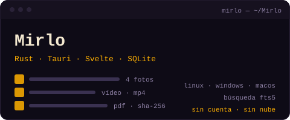
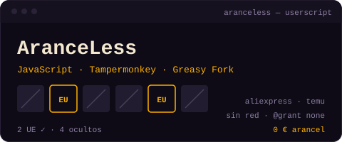
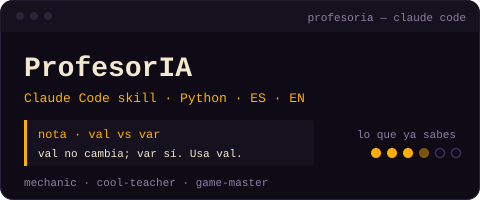
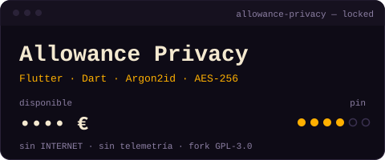

<a href="README-EN.md">English</a> · <b>Español</b>

Esto es una terminal: pulsa cada comando para abrirlo o cerrarlo.

<code>guest@d4vram:~$ ./about</code> &nbsp;sobre mí

 

Hola, soy **D4vRAM**. Programador autodidacta con mente neurodivergente. Aprendo construyendo: si veo un problema, escribo la herramienta que lo resuelve — apps Android, scripts, bots y apps de escritorio. Casi todo lo que hago es open source, local y sin rastreo.

> *"Si algo me gusta de programar es que, si hay un error, siempre es humano."*

- **Cómo aprendo:** Práctica constante, teoría cuando hace falta y la IA como guía personal.
- **Sistemas:** GNU/Linux · Windows · Android
- **Filosofía:** "One day at a time" — 2Pac

<code>guest@d4vram:~$ ls ~/projects</code> &nbsp;proyectos destacados

 

<table>
<tr><td width="50%" valign="top">

   

<b>El problema:</b> Muchas veces quería conservar fuera de Twitter los posts que metía en Guardados y organizarlos mejor, sin perder sus fotos y vídeos. <b>Lo que hice:</b> Un vault inspirado en <a href="https://github.com/D4vRAM369/ThreadsVault-desktop">ThreadsVault-desktop</a>, pero para X/Twitter: guarda en tu disco el texto, las fotos y los vídeos, con colecciones, etiquetas e importación y exportación.

</td><td width="50%" valign="top">

  

<b>El problema:</b> Desde julio de 2026 la UE cobra unos 3 € de arancel por artículo en compras de fuera, y AliExpress y Temu mezclan ese stock con el de sus almacenes europeos. <b>Lo que hice:</b> Un userscript que oculta lo que pagaría la tasa y marca con 🇪🇺 lo que sale desde la UE. Sin peticiones de red. <a href="https://greasyfork.org/es/scripts/602577-aranceless-solo-stock-ue-en-aliexpress-y-temu">Greasy Fork</a>.

</td></tr>
<tr><td width="50%" valign="top">

  

<b>El problema:</b> Programaba con IA, el código funcionaba… y no entendía lo que había construido. Parar a preguntar cada línea mataba el ritmo. <b>Lo que hice:</b> Una skill para Claude Code que deja una nota corta por concepto usando tu propio código, recuerda lo que ya sabes y tiene 3 personalidades de profe. Sin HelloWorld ni quizzes.

</td><td width="50%" valign="top">

   

<b>El problema:</b> Las apps de medicación son pastilleros con alarmas; yo tomo medicación a demanda y quería ver mi patrón. <b>Lo que hice:</b> Un registro de tomas en un toque con un reloj de 24 horas que muestra tu ritmo. Sin permiso de internet, sin cuentas, sin anuncios.

</td></tr>
<tr><td width="50%" valign="top">

  

<b>Qué echaba en falta:</b> Me encanta el minimalismo de Allowance, pero no tenía nada de privacidad para algo tan sensible como mis finanzas. <b>Qué implementé:</b> Un fork con PIN y huella con bloqueo automático, importes ocultos con ••••, copias cifradas con AES-256 y sin permiso de internet ni telemetría.

Fork de <a href="https://github.com/jameskokoska/Allowance">Allowance</a> de James Kokoska
</td><td width="50%" valign="top">

  

<b>El problema:</b> Los audios de WhatsApp sonaban mal en los Pixel. <b>Lo que hice:</b> Un módulo LSPosed con pre-boost de micrófono configurable. Mi primer proyecto publicado.

</td></tr>
</table>

<code>ls -a ~/public-projects</code> &nbsp;+15 más

 

- **[Nisaba](https://github.com/D4vRAM369/Nisaba)**  — Bóveda local de tus conversaciones con Claude Code y Codex: encuentra por palabra o frase lo que hablaste con tu IA y reléelo sin ruido, desde la ventana, la terminal o tu propia IA vía MCP. Sin red.
- **[PlaudVault](https://github.com/D4vRAM369/PlaudVault)**  — Baúl local y cifrado para grabaciones de Plaud Note y otros audios: importa tu historial (audio, transcripciones, notas, infografías), transcribe offline con Whisper y busca en todo con SQLite FTS5. Sin nube.
- **[Vaso de contexto](https://github.com/D4vRAM369/vaso-de-contexto)**  — Medidor local del contexto de tus sesiones de Claude Code: un vaso de agua que se llena y te avisa de cuándo toca `/compact` o `/clear`. Con applet de panel para Linux Mint Cinnamon.
- **[PBL Project Chronicler](https://github.com/D4vRAM369/pbl-project-chronicler)**  — Skill para Claude Code, Codex y OpenCode que convierte cada sesión de desarrollo en documentación de aprendizaje: glosario, paso a paso reproducible, errores y soluciones.
- **[Meta Debug PBL](https://github.com/D4vRAM369/meta-debug-pbl-skill)**  — Skill de depuración metacognitiva para Codex y Claude: explica qué falló, por qué, cómo arreglarlo y verificarlo, y qué aprender de cada error.
- **[DownloadThis](https://github.com/D4vRAM369/downloadthis)**  — Interfaz para yt-dlp: pegas la URL, eliges formato (mp3, flac, opus…) y listo. Cola con progreso, velocidad y ETA, con la estética de eMule y Ares. 100% local.
- **[Anna's Archives Hub](https://github.com/D4vRAM369/annas-archive-hub)**  — Rastreador de mirrors de Anna's Archive: los busca, los verifica y publica un informe en IPFS cada 12 horas.
- **[TapTranslate](https://github.com/D4vRAM369/TapTranslate)**  — Traducción offline ES↔EN desde el menú de selección de texto de Android.
- **[Debuggle](https://github.com/D4vRAM369/Debuggle)**  — Asistente de debugging con IA: pegas un error y te lo explica a tu nivel.
- **[ThreadsVault](https://github.com/D4vRAM369/ThreadsVault)**  — Baúl privado para guardar, etiquetar y anotar posts de Threads en tu dispositivo. Sin cuenta, sin nube, sin rastreo. [Android](https://github.com/D4vRAM369/ThreadsVault) · [Desktop](https://github.com/D4vRAM369/ThreadsVault-desktop).
- **[AhorrApp](https://github.com/D4vRAM369/AhorrApp)**  — Comparador de precios de supermercados en Gran Canaria.
- **[GranCanMatch_bot](https://github.com/D4vRAM369/GranCanMatch_bot)**  — Bot de Telegram para conocer gente en Gran Canaria, sin pagar por match. Ya no está desplegado ni en funcionamiento, debido a una base de datos que nunca llegó a estar a la altura para una funcionalidad viable, y por falta de marketing _(no me gusta el marketing, no es lo mío)_. Quizás sea reabierto en el futuro, pero no está en mis planes por ahora.
- **[PsychoLogger](https://github.com/D4vRAM369/PsychoLogger)**  — Diario privado y cifrado de reducción de riesgos. 100% offline.
- **[Fumitracking](https://github.com/D4vRAM369/Fumitracking)**  — App Android privada y offline para registrar el consumo diario de CBD y THC, con anillos de progreso, objetivos, calendario, estadísticas y widget. Pensada para la reducción de riesgos: sin cuenta, sin rastreo y con copias de seguridad locales cifradas.
- **[NowPlayingExporterPy](https://github.com/D4vRAM369/NowPlayingExporterPy)**  — Exporta a CSV el historial de 'Now Playing' de Pixel rooteados.

<code>guest@d4vram:~$ cat stack.txt</code> &nbsp;con qué trabajo

 

<code>lenguajes</code> 

<code>frameworks</code> 

<code>herramientas</code> 

<code>ia</code> 

<code>guest@d4vram:~$ ./hire-me</code> &nbsp;¿trabajamos juntos?

 

Si necesitas algo de esto, puedo ayudarte:

- Apps Android nativas (Kotlin + Jetpack Compose)
- Scripts y automatizaciones en Python
- Bots de Telegram
- Apps de escritorio (Tauri, Electron)

Cuéntame tu idea por Telegram y lo hablamos.

<code>guest@d4vram:~$ cat /etc/android-freedom</code> &nbsp;

 

> **[WARN]** Desde septiembre de 2026, Google exige registrar tu identidad real para distribuir APKs fuera de Play Store. F-Droid, las apps AOSP y la privacidad están en juego. Hago apps open source porque Android debía ser libre, y estoy totalmente en contra.
> Las restricciones empezarían a aplicarse a nivel mundial en los países en cuales no ha sido aún aplicado el 1 de enero de 2027.
> Sinceramente no me atrevo a especular escenarios de que pasará, funcionará o no, ya que solo el tiempo resolverá esa duda.
> **[Lee qué está pasando y haz ruido →](https://d4vram369.github.io/keep-android-open)**

<code>guest@d4vram:~$ stats --all</code> &nbsp;en números

 

<code>guest@d4vram:~$ sudo brew coffee</code> &nbsp;apóyame

 

Si alguna de mis herramientas te ha ahorrado tiempo, puedes invitarme a un café. Así sigue funcionando el daemon PBL.

<code>guest@d4vram:~$ ./snake --eat contributions</code> &nbsp;actividad

 

  <picture>
    <source media="(prefers-color-scheme: dark)" srcset="https://raw.githubusercontent.com/D4vRAM369/D4vRAM369/output/github-contribution-grid-snake-dark.svg">
    
  </picture>

<code>[WARN] Si encuentras un bug, es humano. Gracias por pasarte.</code>

 

  
 

  <!-- GIFS -->
  
  
  
  

